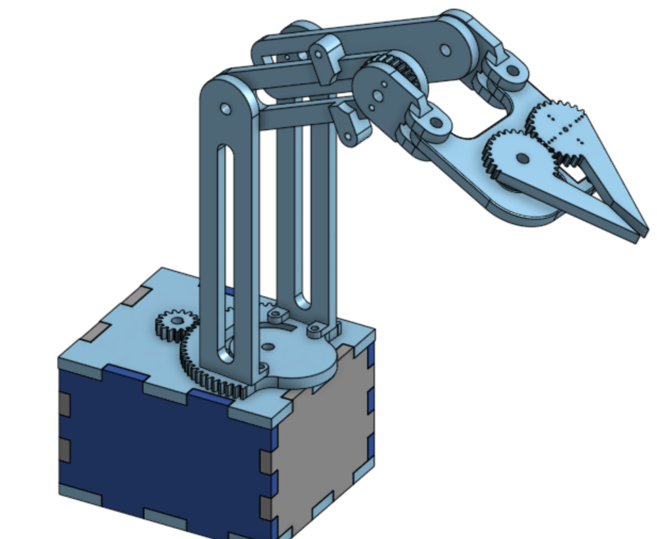

# Robotic arm

Project made to show my skills in robotic and improve them.
### First version -> Last version

  
  

## Index of the Project

- [x] CAD Onshape
- [x] Printing & Assembly
- [ ] Electronics schematics
- [ ] Arduino Codes 
- [ ] Tests 

## Components
| Component | Reference | Quantity |
|-----------|-----------|----------|
| Servo     | FT1017M    | 1        |
| MicroServo     | SG90    | 1        |
| Step motor     | 17he15 1504s    | 1        |
| Step motor     | 28byj-48   | 1        |
| IMU     | MPU6050   | 2        |
| Card     | Arduino Uno  | 1        |
| Battery 12V     | None   | 1        |

## CAD
The modelisations are in the /CAD folder.
Last robotic arm version:

  

Exploded view of the 1st version:

  
  

## Electronics (Coming soon)
## Code
#include <Servo.h>
#include "Stepper.h"
//servo ft1017M
Servo myservo;

int servoPin = 6;     // 

float val = 0;        // la variable qui stocke la valeur lue est mise à 0
bool forward = true;
unsigned long debounce = 0;

// Define number of steps per rotation:
const int stepsPerRevolution = 2048;

// Wiring:
// Pin 8 to IN1 on the ULN2003 driver
// Pin 9 to IN2 on the ULN2003 driver
// Pin 10 to IN3 on the ULN2003 driver
// Pin 11 to IN4 on the ULN2003 driver

// Create stepper object called 'myStepper', note the pin order:
Stepper myStepper = Stepper(stepsPerRevolution, 8, 10, 9, 11);

bool motorState = false;
int motorDirection = 1;

const int buttonPin2 = 2;
const int buttonPin3 = 3;

unsigned long debounce2=0;
unsigned long debounce3=0;

void setup() {
      myservo.attach(servoPin);

      myStepper.setSpeed(5);
      pinMode(buttonPin2, INPUT_PULLUP);
      pinMode(buttonPin3, INPUT_PULLUP);

}

void loop() {
   if(forward) {
    if ((millis() - debounce) > 100){
      val = val + 1;
      myservo.write(val); 
      debounce = millis();
      if(val>130) {
        forward = false;
      }
    }
    }
    else {
      if((millis() - debounce) > 100){
      val =  val - 1;
      myservo.write(val); 
      debounce = millis();
      if(val<10) {
        forward = true;
      }
    }
    }

    if (digitalRead(buttonPin2) == LOW && (millis() - debounce2) > 500) {
    motorState = !motorState;
    debounce2 = millis();
    Serial.println(motorState ? "Motor ON" : "Motor OFF");
    }
  if (motorState) {
    myStepper.step(motorDirection);
  }
  else{
    digitalWrite(8, LOW);
    digitalWrite(9, LOW);
    digitalWrite(10, LOW);
    digitalWrite(11, LOW);
  }

if (digitalRead(buttonPin3) == LOW && (millis() - debounce3) > 500) {
    motorDirection = -motorDirection;
    debounce3 = millis();
  }

}