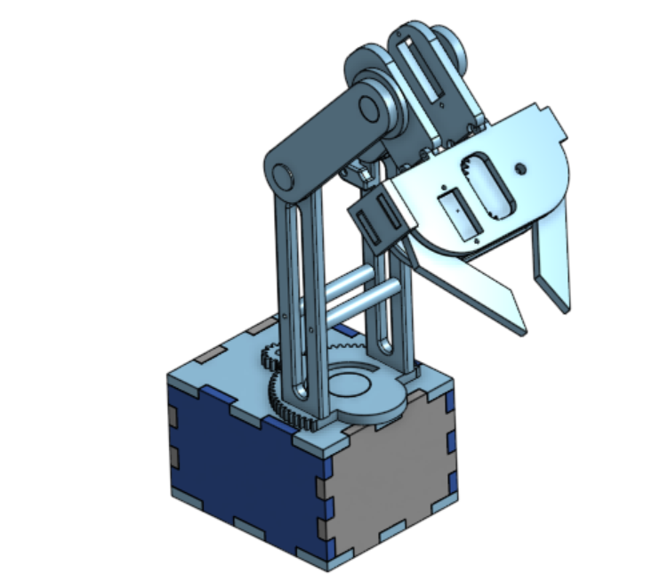
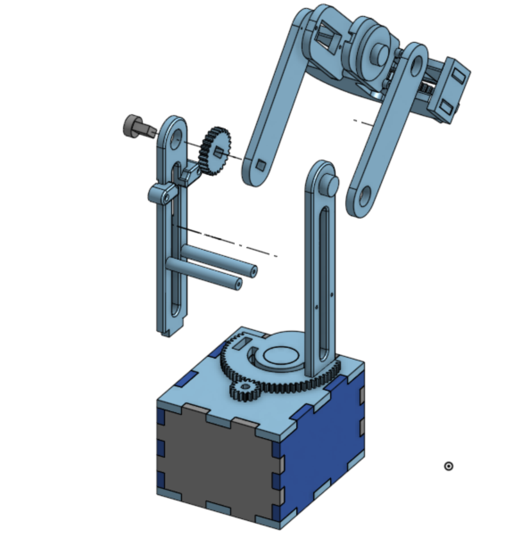

# Robotic arm

Project made to show my skills in robotic and improve them.

## Index of the Project

- [x] CAD Onshape
- [ ] Electronics schematics
- [ ] Codes Arduino 
- [ ] Tests 

## Componant
   Composant | Reference | Quantity |

## CAD
The modelisations are in the /CAD folder.

## Electronics (On coming)
## Code (On coming)

