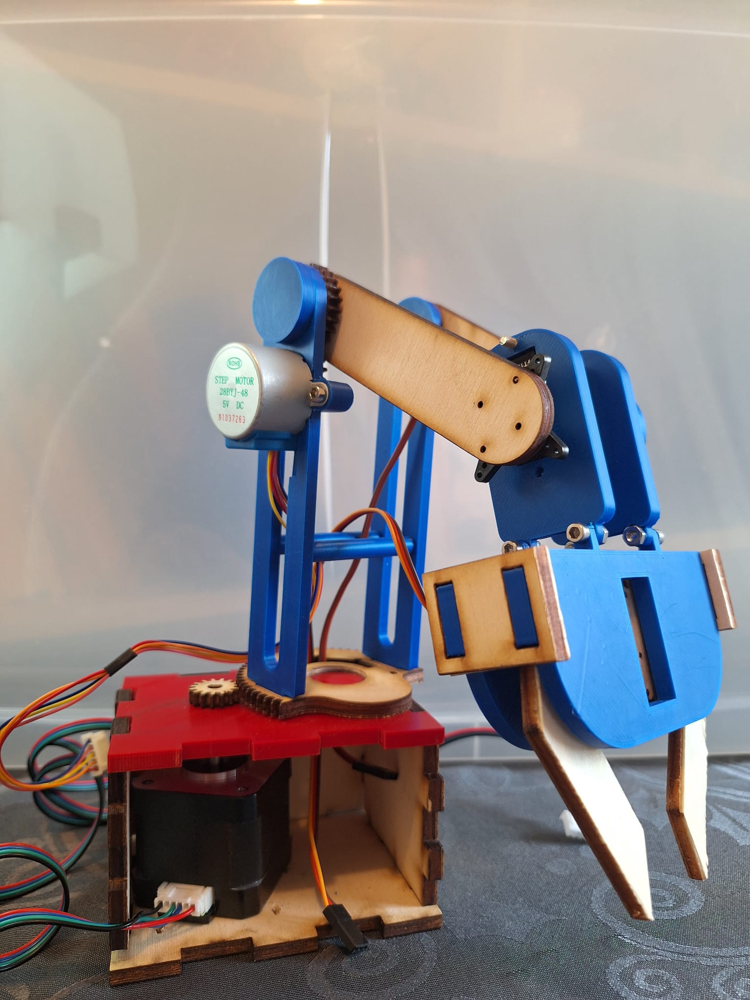
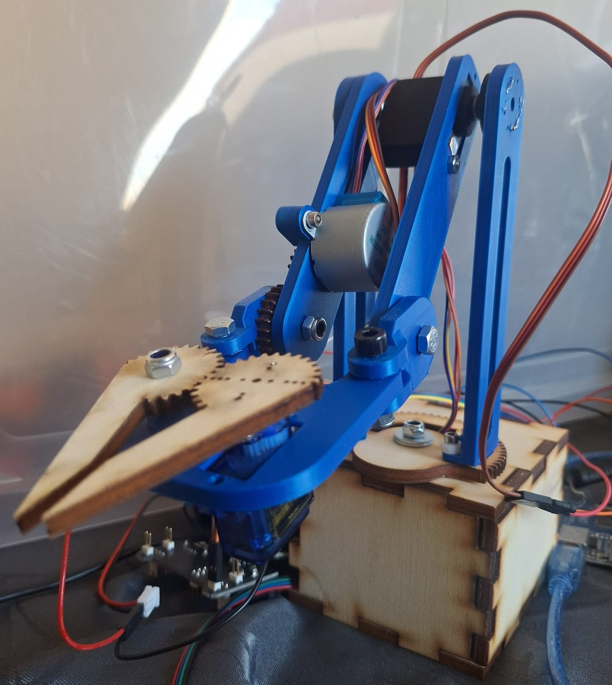
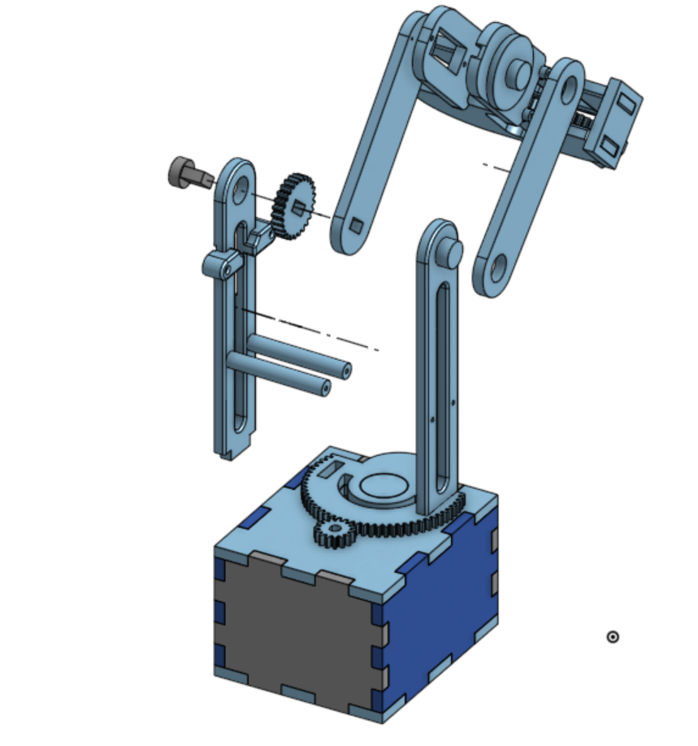
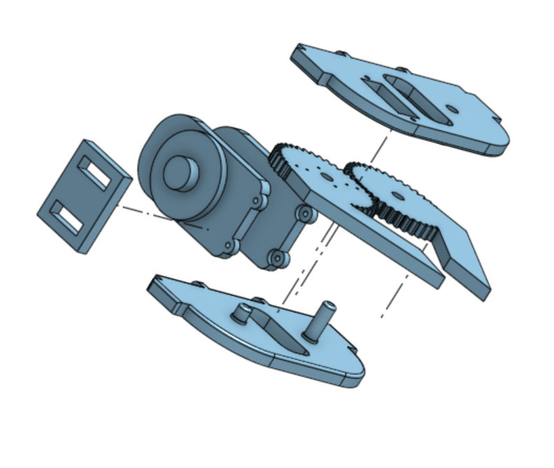

# Robotic Arm
(Work in progress)

Project made to show and improve my skills: a 3-axis robotic arm made with what I had on hand. The housing is half printed and half cut with laser. For now it is controlled by an Arduino which will be replaced by an ESP32 in the future.
### First version -> Last version

  
  

## Index of the Project

- [x] CAD Onshape
- [x] Printing & Assembly
- [ ] Electronics schematics
- [ ] Arduino Codes 
- [ ] Tests 

## Components
| Component | Reference | Quantity |
|-----------|-----------|----------|
| Servo     | FT1017M    | 1        |
| MicroServo     | SG90    | 1        |
| Step motor     | 17he15-1504s    | 1        |
| Step motor     | 28byj-48   | 1        |
| IMU     | MPU6050   | 2        |
| Board     | Arduino Uno  | 1        |
| Battery 12V     | None   | 1        |

## CAD
The modelisations are in the /CAD folder.
Last robotic arm version:

  

Exploded view of the 1st version:

  
  

## Electronics (Coming soon)

## Code
The Arduino source is in firmware/robot_arm/